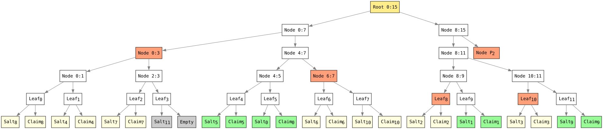
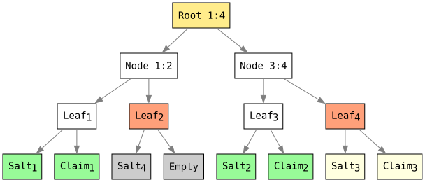
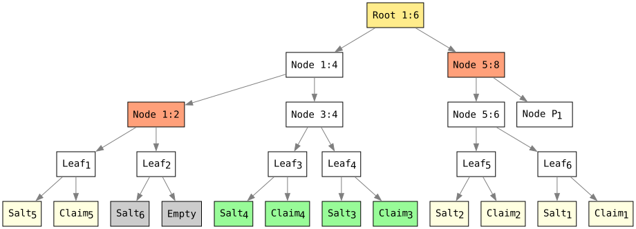

> [!NOTE]
> 🚧 **Work in Progress** - Feedback of any kind is welcome, stars speed up progress, and contributions are highly appreciated! Feel free to open an issue or submit a pull request.

# Salted Merkle Tree for Selective Disclosure

A Salted Merkle tree is a cryptographic commitment structure. Selective disclosure is achieved by revealing only the targeted leaf nodes data and their corresponding verification path while keeping undisclosed claims private. It enables a verifier to validate disclosed claims against a single Merkle root. The design prioritizes security, privacy, and computational efficiency.

The tree is binary and balanced, using unique padding hashes to handle missing siblings without explicitly constructing or storing all padding nodes. This reduces the space and computational overhead associated with materializing a fully padded tree. Each leaf hash is salted to prevent offline dictionary attacks against the underlying claims.

For `n` leaves, root computation takes `O(n)` time and `O(n)` space, while the tree depth is `O(log n)`. Verification path generation takes `O(n)` time and `O(n)` space. An individual verification path contains `O(log n)` hashes. For `m` disclosed claims, root reconstruction takes `O(m log m + p)` time, where `p` is the number of hashes in the verification path, and `O(m)` space, excluding the input claims, salts, indices, and path. When multiple leaves are disclosed, their verification paths can share common nodes, reducing the total proof size.

## Design Objectives

- Secure Verification: Uses distinct domain-separation prefixes for leaf data, internal nodes, and padding values to distinguish hash inputs by type. Verification recomputes the commitment according to deterministic hashing rules and compares the resulting root with the trusted commitment.
- Privacy: Keeps undisclosed contents private while allowing disclosed claims to be independently verified.
- Unlinkability: Protects the privacy of the total number of claims and the distribution of undisclosed claims during selective disclosure. Its three-party model avoids direct verifier–issuer communication during verification, preventing verification-time call-home interactions and reducing issuer tracking.
- Computational Efficiency: Supports bottom-up root computation, verification path generation, and bottom-up verification with limited intermediate storage. For multiple disclosed elements, shared verification nodes are reused to reduce proof size, memory requirements, and verification overhead.
- Structural Simplicity: Uses deterministic, salted padding to handle incomplete node pairs according to a fixed construction rule, avoiding ad hoc tree restructuring.

## Cryptographic Properties

- Deterministic Construction: Defines consistent leaf hashing, internal-node hashing, and padding rules, ensuring reproducible commitments for the same ordered input.
- Efficient Selective Disclosure: Enables verification of disclosed elements using sibling hashes and positional information to reconstruct and verify the Merkle root. Multiple disclosed elements share common verification nodes. 
- Salted Padding: Uses deterministic, salted padding hashes to handle non-power-of-two leaf counts consistently while keeping the total number of claims private. To the verifier, padding nodes are indistinguishable from other nodes and leafs.

These properties provide a deterministic and efficient basis for privacy-preserving selective disclosure, enabling verification of disclosed data while keeping undisclosed leaf contents and the total number of claims private, subject to the security of the underlying hash function and the confidentiality of the disclosed data itself.

## Datasets

Any dataset that supports a deterministic, unidirectional mapping between its native representation and an ordered sequence of canonicalized claims can be used for selective disclosure using a salted Merkle tree.

A claim is an atomic, canonicalized unit of information derived from a dataset that can be independently represented, committed to, and selectively disclosed. Each claim is encoded in a deterministic canonical form so that equivalent claims produce identical representations.

> Note: This document specifies algorithms for datasets represented as JSON, JSON-LD, and RDF (N-Quads). See _Appendix_.

## Actors

Conceptual separation among the Issuer, Holder, and Verifier isolates trust domains. The Issuer establishes cryptographic commitment via digital signing, the Holder executes selective disclosure, and the Verifier performs stateless validation. The three-party model enforces cryptographic separation of duties and ensures that the Verifier verifies claims via non-interactive path validation without establishing communication channels with the Issuer, thereby eliminating online tracking and preserving unlinkability across protocol sessions.

> Note: The Issuer and Holder roles may coincide as a single entity in self-issued scenarios.

### Issuer

An entity that instantiates a cryptographic commitment scheme over a dataset by serializing claims into a canonical sequence, mapping them to a sparse vector of dimension M via a keyed pseudorandom slot-distribution function, computing a salted Merkle tree root, and generating a digital signature over the root. The Issuer transmits the signed root, verification key, HMAC secret key `K`, leaves dimension `M`, and dataset to the Holder.

- Canonicalize and flattens the dataset into an ordered list of claims.
- Distributes the claims across an array of size `M` using the secret-keyed HMAC slot-distribution algorithm. Generates HMAC secret key `K`.
- Generates the root.
- Signs the root using the issuer's private key.
- Shares the following with the holder:
  - The signed root.
  - The issuer's public key.
  - The secret key `K` and leaves array size `M`.
  - The dataset.

> Node: The HMAC secret key `K` is never shared with the verifier; it is used to hide the original claims distribution and to add entropy to the leaf hashes, preventing dictionary attacks and brute-force attacks.
> 
> The issuer uses its asymmetric key pair and signature scheme to sign the commitment. The issuer's private key must remain strictly uncompromised and unshared.

### Holder (disclosing party)

An entity acting as a cryptographic prover in a selective disclosure protocol that receives the dataset, HMAC secret key `K`, array dimension `M`, and signed root from the Issuer. The Holder is responsible for serializing the dataset into a canonical sequence, mapping claims to a sparse vector of dimension `M` via the keyed slot-distribution function, computing cryptographic verification path for a subset of targeted claims, and transmitting the proofs and public parameters to the Verifier.

- Canonicalize and flattens the dataset into an ordered list of claims.
- Distributes the claims across an array of size `M` using the same HMAC slot-distribution algorithm and secret key `K`.
- Selects the claims to disclose.
- Generates the verification path for the selected claims.
- Shares the following with the verifier:
  - The selected claims in their dataset representation.
  - The selected claims salts and assigned slot indices.
  - The corresponding verification path.
  - The issuer's signed Merkle root.

### Verifier

An entity that acts as a verifier in a selective disclosure protocol, responsible for authenticating the subset of claims revealed by the Holder. The Verifier reconstructs the tree root from the disclosed claims, their respective salts, slot indices, and verification path, and cryptographically validates the issuer's digital signature over the reconstructed root using the issuer's public key.

- Canonicalize and flattens the relevant dataset into an ordered list of claims.
- Reconstructs the root from the disclosed claims, salts, indices, and verification path.
- Verifies the issuer's signature on the reconstructed root using the issuer's public key.
- Accepts the disclosed claims only if signature verification.

### Example

The example shows a tree with 11 claims, padded to an even number, i.e., 12 leaves. The underlying claims for leaves 1, 2, 8, and 11 are disclosed, while the remaining claims stay private. The verification path include the hashes for leaves 7 and 12, nodes 3:4, 5:6, 9:10 and P2 (depth-based padding level 2), allowing the verifier to reconstruct and verify the root.



## Algorithms

The selective disclosure process involves three core algorithms, used by the issuer, the holder (the disclosing party), and the verifier:

- Root Computation: The issuer computes a root from the complete, ordered set of leaf hashes. The root serves as a commitment to the dataset.
- Verification Path Generation: The holder (the disclosing party) selects the leaves to reveal and generates their verification path. The path provide the additional hashes needed to verify the disclosed leaves without revealing the rest.
- Root Reconstruction and Verification: The verifier uses the disclosed claims, salts, indices, and verification path to reconstruct the root. The disclosed data is accepted as consistent with the original commitment if the reconstructed root matches the trusted root.

The algorithms enable the issuer to commit to a dataset, the disclosing party to reveal selected leaves, and the verifier to check them against the original commitment.

### Root Computation

**Input**: An ordered sequence of `n` leaf hashes, where `n` is even and `n > 1`.

**Output**: The root hash.

1. Compute the tree depth as `depth = ceil(log2(n))`.
2. Set the current `level_size` to `n`.
3. For each `level` from `0` to `depth - 1`:
   1. Process the current level in adjacent pairs, from left to right, using `level_size`.
   2. For each pair, compute the parent hash as `H(0x01 || left || right)`.
   3. If the final node has no right sibling, use the depth-based padding hash for the current `level` as its right sibling and increment the current `level_size` to account for the padded node.
   4. Store each parent hash in the same array at index `floor(i / 2)`, overwriting the entries of the previous level from left to right, where `i` is the index of the left child.
   5. Update the current `level_size` to `ceil(level_size / 2)`.
3. Return the hash at index zero as the root.

The algorithm reuses a single array to store successive tree levels, avoiding the need to allocate a separate array for each level. It terminates when the current level contains exactly one hash.

#### Complexity

Let `n` be the number of leaves:

- Time Complexity: `O(n)`. The algorithm hashes each leaf once and computes one parent hash per node pair, including pairs completed using padding. The total number of internal-node hashes is `n - 1`.
- Space Complexity: `O(n)`. The algorithm stores leaf hashes in a single array and reuses that array for successive tree levels, avoiding additional arrays proportional to the number of leaves.

These bounds assume fixed-size hash outputs and constant-time hash operations.

### Verification Path Generation

**Input**: An ordered sequence of `n` leaf hashes, where `n` is even and `n > 1`, and a selected leaf hashes are not set. Only not selected leaf hashes are computed and present.

**Output**: An ordered sequence of verification path hashes.

1. Compute the tree depth as `depth = ceil(log2(n))`.
2. Set the current `level_size` to `n`.
3. For each `level` from `0` to `depth - 1`:
   1. Process the current level in adjacent pairs, from left to right, using `level_size`.
   2. If the final node has no right sibling, use the depth-based padding hash for the current `level` as its right sibling and increment the current `level_size` to account for the padded node.
   3. For each pair where `i` is the index of the left child:
      1. If the left child is not set and the right child is present, append the right child to the verification path and unset the parent entry at index `floor(i / 2)`.
      2. If the right child is not set and the left child is present, append the left child to the verification path and unset the parent entry at index `floor(i / 2)`.
      3. If the left child is present and the right child is present, compute the parent hash as `H(0x01 || left || right)` and store it at index `floor(i / 2)`.
      4. Otherwise, unset the parent entry at index `floor(i / 2)`.
   4. Update the current `level_size` to `ceil(level_size / 2)`.
4. Return the verification path hashes.


The algorithm reuses a single buffer to store successive tree levels, promoting only nodes that were neither selected nor already added to the verification path, avoiding the need to allocate a separate array for each level and unnecessary computations.

#### Complexity

Let `n` be the number of leaves:

- Time Complexity: `O(n)`. The algorithm processes the nodes at each tree level, performing constant-time checks and updates for each node. Since the number of nodes decreases geometrically at each level, the total number of node operations across all levels is `O(n)`. Hash computations are performed only for undisclosed leaves and their parent nodes.
- Space Complexity: `O(n)`. The algorithm reuses a single array to store successive tree levels and stores the verification path, which can contain up to `O(log2(n))` hashes for a single selected leaf.

These bounds assume fixed-size hash outputs, constant-time hash operations.

### Root Reconstruction

**Input**: A sequence of disclosed claims, their corresponding salts and original leaf indices, and a verification path hashes in verification order.

**Output**: The reconstructed root hash.

1. Initialize `mapping` with the indices of the disclosed claims and sort it by ascending original leaf index.
2. Initialize `buffer` to hold the disclosed leaf hashes and set `level_size` to the number of disclosed claims.
3. For each disclosed claim, compute its leaf hash as `H(0x00 || salt || claim)` and store it in `buffer`. Update the corresponding `mapping` entry to the claim's original leaf index.
4. While `level_size > 1` or unconsumed verification path hashes remain:
   1. Set `next_level_size = 0`.
   2. Process the current level from left to right, using the mapping to determine each node's position.
   3. For each node at position `node_index`:
      1. If `node_index` is odd, consume the next verification path hash as the left sibling, use the current buffer entry as the right child, and compute the parent hash as `H(0x01 || left || right)`.
      2. Otherwise, if the right node is present and its mapping entry equals `node_index + 1`, compute the parent hash from the current node and the next node as `H(0x01 || left || right)`, and advance iterator past both children.
      3. Otherwise, consume the next verification path hash as the right sibling, use the current entry as the left child, and compute the parent hash as `H(0x01 || left || right)`.
      4. Store the parent hash at index `next_level_size` in the `buffer` and store `floor(node_index / 2)` at the corresponding mapping entry.
      5. Increment `next_level_size`.
   4. Set `level_size` to `next_level_size`.
5. Return `buffer[0]` as the reconstructed root.

The algorithm sorts disclosed claims by their original leaf indices and reconstructs successive tree levels in place using `buffer` and `mapping` arrays sized to the number of disclosed claims, consuming verification path hashes only when a sibling is not among the disclosed nodes being processed.

#### Complexity

Let `m` be the number of disclosed claims and `p` the number of verification path hashes:

- Time Complexity: `O(m * log2(m) + p)`, Sorting takes `O(m * log2(m))`. During reconstruction, the number of nodes processed decreases at each level as pairs are combined into parents, so the total number of nodes processed across all levels is `O(m)`. Each of the `p` verification path hashes is consumed at most once, adding `O(p)` time.
- Space Complexity: `O(m)`, The algorithm uses a mapping array and a buffer proportional to the number of disclosed claims, reusing both arrays to store successive tree levels.

These bounds assume fixed-size hash outputs and constant-time hash operations.

### Leaf Hashes Computation

**Input**: An ordered sequence of `n` claims, their salts, a mapping from claim positions to leaf positions, and optional sorted indices of claims to omit.

**Output**: An ordered sequence of leaf hashes, with selected claims left unassigned and a padding leaf added if `n` is odd.

1. Initialize an array of size `n`, adding one extra slot if `n` is odd.
2. For each claim at index `i`:
   1. If no claims are selected for omission, or `i` does not match the next selected index, compute `H(0x00 || salts[i] || claims[i])` and store it at the leaf position specified by the mapping.
   2. Otherwise, omit the claim's leaf hash and advance to the next selected index.
3. If `n` is odd, compute the padding leaf as `H(0x00 || salts[n])` and store it at the position specified by the mapping for `n`.
4. Return the array of leaf hashes.

#### Complexity

- Time Complexity: `O(n)`, as each claim is processed once and at most one padding leaf is computed.
- Space Complexity: `O(n)` for the output buffer, including the optional padding leaf.

### Salt Generation, Claims Distribution, and Hash Computation

Salt Generation. Generate salts for all claims, ensuring the total number of salts is even by adding one additional entry if the number of claims is odd. Each salt is derived as `HMAC(K, 0x10 || uint32_be(i))`, where `i` is the origin claim index.

> Note: A unique, cryptographically random salt prevents attackers from efficiently guessing the contents of undisclosed leaves by precomputing hashes of likely values and comparing them against published hashes. This protection relies on keeping the salt secret for undisclosed leaves. The issuer and disclosing party can share a secret seed and deterministically derive each leaf's salt from its index, avoiding the need to store or transmit individual salts. When a leaf is disclosed, its salt must be revealed alongside the data so verifiers can recompute its hash.

Claims Distribution. Initialize the mapping with the original claim indices and sort them by their corresponding salts in ascending lexicographic order. The resulting mapping assigns each original claim index to its leaf slot in the tree.

> Note: Distributing claims according to positions derived from HMAC of their original indices using a secret key obscures the relationship between original claim indices and their positions in the Merkle tree, making it harder to infer the original ordering of claims or identify undisclosed claims by their tree positions.

Leaf Hash Computation. Compute each leaf hash as `H(0x00 || salt || claim)`. For a padding leaf, omit the data component, yielding `H(0x00 || salt)`.

Internal Node Hash Computation. Compute each parent hash as `H(0x01 || left || right)`, preserving the order of the left and right child hashes.

Level Padding. For a missing sibling at tree `level > 0`, derive the padding hash as `H(0x02 || HMAC(K, 0x11 || uint32_be(level)))`. The level-specific padding allows incomplete tree levels to be handled without explicitly materializing all padding nodes.

> Note: Domain separation prefixes for salt generation, leaf hashing, internal node computation, and level padding ensure that inputs from different structural contexts remain strictly separated, preventing hash collisions, type-confusion attacks, or second-preimage vulnerabilities between different node types and derivation steps.

## Mandatory Claims

Mandatory claims must always be disclosed to the verifier. Processing them as selectively disclosable claims with disclosure always enabled is computationally inefficient; they require a separate algorithm.

Datasets containing both mandatory and optional claims should be split into two parts: one processed by the mandatory-claims algorithm and the other by the selective-disclosure algorithm.

i.e. A combined tree with two child hashes, one for the mandatory claims and one for the selective-disclosure root, allows a single commitment to cover both while keeping the algorithms separate.

## Security Considerations

### Padded Leaf Size Estimation

Padded leaf sizes follow discrete tiers determined by `2 ^ ceil(log2(claims))`. While structural indicators allow observers to estimate which size tier applies, the presence of empty slots alongside actual claims conceals the exact total claim count. Sparse vector dimensions balance performance with resistance to size-estimation analysis.

### Verification Resource Limits

Verifiers should enforce configurable limits on the number of disclosed claims, the total size of the received dataset and verification path, the magnitude of claim indices, and the computational resources consumed during canonicalization and root reconstruction. These limits help prevent denial-of-service attacks caused by excessively large or computationally expensive disclosure proofs. Inputs exceeding the configured limits should be rejected before expensive processing begins.

## Appendix

### JSON Dataset

JSON datasets are structured as hierarchical collections of objects and arrays. Selective disclosure requires mapping this structure to independently committable claims while preserving each value's location and identity within the original document. JSON Pointers provide stable references to individual values, while canonicalization ensures deterministic encoding independent of superficial serialization differences.

- Canonicalize the dataset using the JSON Canonicalization Scheme (JCS, RFC 8785).
- Flatten the canonicalized JSON into an ordered sequence of claims, one per JSON value at a defined JSON Pointer.
- Encode each claim as: `UTF8(JSONPointer) || 0x00 || JCS(value)` where `JSONPointer` follows RFC 6901, `UTF8` encodes the pointer as UTF-8, `0x00` is a separator, and `value` is the UTF-8 encoding of the value serialized according to JCS.
- Preserve a deterministic ordering of claims to ensure consistent commitment generation and verification.

#### Example

Consider a JSON document containing three statements:

```json
{
  "name", "Filip",
  "city", "Prague",
  "country", "Czech Republic"
}
```

JCS canonicalization produces:

```json
{"city":"Prague","country":"Czech Republic","name":"Filip"}
```

The flattening rule recursively traverses objects in order of the JCS canonicalized document. Each scalar value becomes a claim encoded as the UTF-8 bytes of its JSON Pointer (RFC 6901), followed by the 0x00 separator and the UTF-8 bytes of its JCS canonicalized value. Container values are not emitted as claims; only their descendants are included.

For the example above, flattening produces three claims, each represented as a byte array:

```
0: UTF8("/city") || 0x00 || UTF8("\"Prague\"")
1: UTF8("/country") || 0x00 || UTF8("\"Czech Republic\"")
2: UTF8("/name") || 0x00 || UTF8("\"Filip\"")
```

Using the following test HMAC secret key (hex-encoded):

```
00112233445566778899AABBCCDDEEFF00112233445566778899AABBCCDDEEFF
```

Salt generation and claim distribution produce the following deterministic outputs:

```javascript
salts = [
  "03237fd5b59cdd7d77b7f4e7d8060ac9abe2ff38b3fc8ad746751957129d0819",
  "2e42d305c3888a55c992514a4b635f0739ceb3fe02584f522703df1551938091",
  "0d5179c215af6add040e76606c4ec726de65fbfd6a30df73fb8d00744f1ce215",
  "24e203e63059712675d0f27af19e17c212fadd6ef0d16492f4b86068084f3614"
]
mapping = [0, 2, 3, 1]
```

Applying the root computation algorithm produces the following root hash:
```
ffc7679ee3d4e7472b886e731b6c853d5384c4b1cbd191759cd31a497a3ac7d6
```

The figure below shows the complete Merkle tree constructed by the issuer and holder using these salts and the resulting mapping.



Assume the holder selects claims at original indices `0` and `1` for disclosure. Claim indices in the examples are zero-based, while claims in the diagram are numbered from `1`; therefore, the selected claims correspond to claims `1` and `2` in the diagram.

Applying the verification path generation algorithm produces the following proof data, which the holder sends to the verifier alongside the disclosed dataset and the issuer's signed root:

```javascript
dataset = {
  "city": "Prague",
  "country": "Czech Republic"
}
salts = [
  "03237fd5b59cdd7d77b7f4e7d8060ac9abe2ff38b3fc8ad746751957129d0819",
  "2e42d305c3888a55c992514a4b635f0739ceb3fe02584f522703df1551938091"
]
path = [
  "46d2beb76d8fd5d41daf290e037fec622fc83ecf677598c6c117095688a45ee1",
  "b3a49a28389c75494f9760a4f8c5ca557c380818d5f4782972069f792384bf51"
]
indices = [0, 2]
signature = Sig(root:"ffc7679ee3d4e7472b886e731b6c853d5384c4b1cbd191759cd31a497a3ac7d6")
```

The verifier uses the disclosed claims, their salts and indices, the verification path, and the issuer's signature to reconstruct the Merkle root and verify the claims' integrity and authenticity without revealing the remaining claims.

> Note: For demonstration purposes, byte arrays are represented as hexadecimal-encoded strings.

### RDF Dataset

RDF datasets represent information as RDF statements, each consisting of a subject, predicate, object, and graph name. Selective disclosure treats each statement as an independently committable claim. 

- Canonicalize the RDF dataset using RDF Dataset Canonicalization (RDFC-1.0), preserving the mapping between original blank node identifiers and their canonical identifiers.
- Relabel the canonical blank node identifiers using HMAC with the one-time key (OTK), preserving the mapping between canonical blank node identifiers and their HMAC-derived labels.
- Serialize the relabeled dataset as N-Quads.
- Treat each N-Quads statement as a separate claim, encoded as its UTF-8 byte sequence.
- Preserve the canonical statement order and the blank node label maps required to consistently identify and disclose claims during proof generation and verification.

> Note: Before sharing the blank node label map with the verifier, it must be updated to reflect the canonical blank node identifiers resulting from the disclosed subset. The map associates each canonical blank node identifier with its HMAC-derived label. Blank nodes that do not occur in the disclosed statements must be excluded, and the remaining canonical identifiers must be renumbered consistently with the disclosed subset. For example, if the original map contains three blank nodes but only the third appears in the disclosure, the shared map must update that node's canonical identifier to the first blank node identifier, while retaining its corresponding HMAC-derived label.

#### Example

Consider an RDF dataset containing the following statements, represented in N-Quads:

```nquads
_:b0 <http://www.w3.org/1999/02/22-rdf-syntax-ns#type> <http://schema.org/Person> .
_:b0 <http://schema.org/name> "Filip Kolařík" .
_:b0 <http://schema.org/city> "Prague" .
_:b0 <http://schema.org/country> "Czech Republic" .
_:b0 <http://schema.org/url> "https://github.com/filip26" .
```

RDFC-1.0 canonicalization produces a deterministic N-Quads representation. Each resulting line, including its terminating period and required whitespace, is encoded as UTF-8 and becomes one claim. Blank nodes are relabeled using HMAC with OTK:

```text
0: UTF8("_:4d654d204d8cb959b00c0ddb03c8b9deca93cf80cfcae435fa6769ef9ff88dc9 <http://schema.org/city> "Prague" .\n")
1: UTF8("_:4d654d204d8cb959b00c0ddb03c8b9deca93cf80cfcae435fa6769ef9ff88dc9 <http://schema.org/country> "Czech Republic" .\n")
2: UTF8("_:4d654d204d8cb959b00c0ddb03c8b9deca93cf80cfcae435fa6769ef9ff88dc9 <http://schema.org/name> "Filip Kolařík" .\n")
3: UTF8("_:4d654d204d8cb959b00c0ddb03c8b9deca93cf80cfcae435fa6769ef9ff88dc9 <http://schema.org/url> "https://github.com/filip26" .\n")
4: UTF8("_:4d654d204d8cb959b00c0ddb03c8b9deca93cf80cfcae435fa6769ef9ff88dc9 <http://www.w3.org/1999/02/22-rdf-syntax-ns#type> <http://schema.org/Person> .\n")
```
label map:

```javascript
{
  "c14n0" : "4d654d204d8cb959b00c0ddb03c8b9deca93cf80cfcae435fa6769ef9ff88dc9"
}
```

> Note: The issuer generates the HMAC one-time key (OTK) to derive the HMAC-based blank node labels and then discards the key. The resulting blank node label map is shared with the holder unchanged and is used during selective disclosure.

Using the following test HMAC secret key (hex-encoded):

```
FFEEDDCCBBAA99887766554433221100FFEEDDCCBBAA99887766554433221100
```

Salt generation and claim distribution produce the following deterministic outputs:

```javascript
salts = [
  "...",
  "...",
  "...",
  "...",
  "..."
]
mapping = [5, 4, 3, 2, 0, 1]
```

Applying the root computation algorithm produces the following root hash:

```
```

The figure below shows the complete Merkle tree constructed by the issuer and holder using these salts and the resulting mapping.



Assume the holder selects claims at original indices `2` and `3` for disclosure. Claim indices in the examples are zero-based, while claims in the diagram are numbered from `1`; therefore, the selected claims correspond to claims `3` and `4` in the diagram.

Applying the verification path generation algorithm produces the following proof data, which the holder sends to the verifier alongside the disclosed dataset and the issuer's signed root:

```nquads
_:b0 <http://schema.org/url> "https://github.com/filip26" .
_:b0 <http://schema.org/name> "Filip Kolařík" .
```

```javascript
salts = [
  "...",
  "..."
]
path = [
  "...",
  "..."
]
indices = [3, 2]
labels = [
  "4d654d204d8cb959b00c0ddb03c8b9deca93cf80cfcae435fa6769ef9ff88dc9"
]
signature = Sig(root:"...")
```

The issuer and holder apply the same canonicalization, blank node relabeling, and claim-encoding rules before computing the Merkle tree and generating disclosure proofs. The verifier canonicalizes the disclosed RDF dataset and applies the corresponding blank node relabeling and claim-encoding rules to reconstruct the disclosed claims. Using these claims, their salts and indices, and the verification path, the verifier reconstructs the Merkle root and verifies the issuer's signature without receiving the undisclosed statements.

> Note: Each claim is the UTF-8 encoding of one canonical N-Quads line, including its line terminator. For demonstration purposes, byte arrays may be represented as hexadecimal-encoded strings.

### Implementation Note

The `ceil`, `floor`, and `log2` operations can be implemented using integer arithmetic and bitwise operations, avoiding floating-point calculations and reducing computational overhead.

| Operation                    | Integer/bitwise equivalent                |
| ---------------------------- | ----------------------------------------- |
| `ceil(log2(n))`, for `n > 1` | `bit_length(n - 1)`                       |
| `floor(n / 2)`               | `n >>> 1` in Java                         |
| `ceil(n / 2)`                | `(n + 1) >>> 1` for non-negative integers |
| `2 ^ n`                      | `1 << n`                                  |
| `2 * ceil(n / 2)`            | `n + (n & 1)`                             |
| `n * 2`                      | `n << 1`                                  | 
| `uint32_be(n)`               | `[(n >> 24) & 0xFF, (n >> 16) & 0xFF, (n >> 8) & 0xFF, n & 0xFF]` |

Here, `bit_length(x)` is the number of bits in the binary representation of `x`. e.g. in Java, it can be computed as `32 - Integer.numberOfLeadingZeros(x)` for positive `int` values.

### Implementations

[SaltedMerkleTree.java](https://github.com/filip26/iron-verifiable-credentials/blob/main/selective-disclosure/salted-merkle-tree/src/main/java/com/apicatalog/smt/SaltedMerkleTree.java)

## License

This work is licensed under the [Creative Commons Attribution 4.0 International (CC-BY-4.0)](https://github.com/filip26/salted-merkle-tree?tab=CC-BY-4.0-1-ov-file#) license.

## References

1. Rundgren, A., Jordan, B., & Erdtman, S. (2022). *JSON Canonicalization Scheme (JCS).* RFC 8785. Internet Engineering Task Force (IETF). https://www.rfc-editor.org/rfc/rfc8785

2. Longley, D., & Sporny, M. (Eds.). (2024). *RDF Dataset Canonicalization 1.0.* World Wide Web Consortium (W3C). https://www.w3.org/TR/rdf-canon/

3. Bray, T. (Ed.). (2017). *The JavaScript Object Notation (JSON) Data Interchange Format.* RFC 8259. Internet Engineering Task Force (IETF). https://www.rfc-editor.org/rfc/rfc8259

4. Krawczyk, H., Bellare, M., & Canetti, R. (1997). *HMAC: Keyed-Hashing for Message Authentication.* RFC 2104. Internet Engineering Task Force (IETF). https://www.rfc-editor.org/rfc/rfc2104

5. Jones, M., Bradley, J., & Sakimura, N. (2015). *JSON Web Signature (JWS).* RFC 7515. Internet Engineering Task Force (IETF). https://www.rfc-editor.org/rfc/rfc7515

6. National Institute of Standards and Technology (NIST). (2015). *Secure Hash Standard (SHS).* FIPS PUB 180-4. https://doi.org/10.6028/NIST.FIPS.180-4

7. Merkle, R. C. (1988). A digital signature based on a conventional encryption function. In C. Pomerance (Ed.), *Advances in Cryptology—CRYPTO ’87* (pp. 369–378). Springer. https://doi.org/10.1007/3-540-48184-2_32

8. World Wide Web Consortium (W3C). (2025). *Verifiable Credential Data Integrity 1.0.* W3C Recommendation. https://www.w3.org/TR/vc-data-integrity/

9. World Wide Web Consortium (W3C). (2025). *Data Integrity ECDSA Cryptosuites v1.0.* W3C Recommendation. https://www.w3.org/TR/vc-di-ecdsa/

10. Laurie, B., Messeri, E., & Stradling, R. (2021). *Certificate Transparency Version 2.0.* RFC 9162. Internet Engineering Task Force (IETF). https://www.rfc-editor.org/rfc/rfc9162

